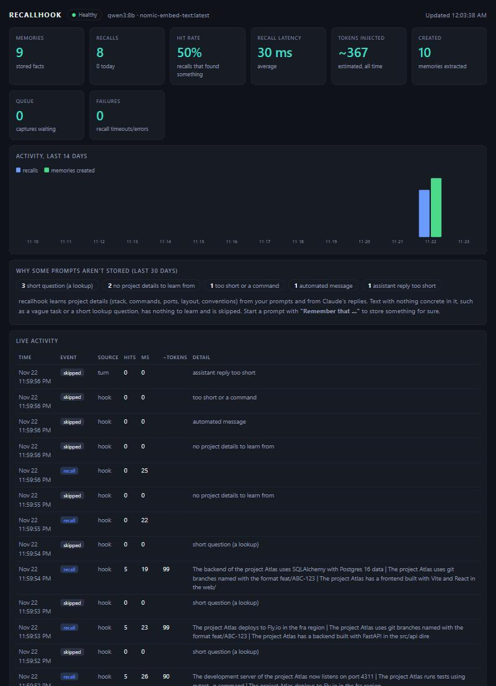
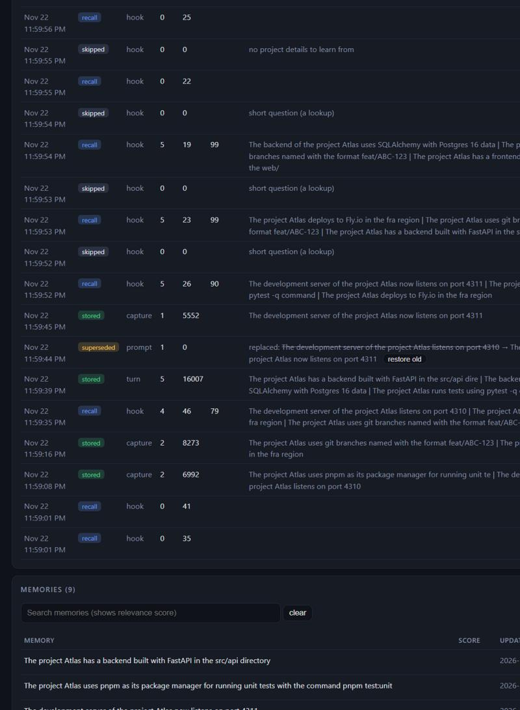

# recallhook

[](https://github.com/DEVPARMAR06/recallhook/actions/workflows/test.yml) [](https://pypi.org/project/recallhook/)  

**Private, local long-term memory for Claude Code.** Tell Claude something once, like *"I use pnpm"* or *"Atlas deploys to Fly.io"*, and every future session already knows it, in the **Claude desktop app, the VS Code extension and the terminal**.

No cloud, no proxy, no API key: a Claude Code hook + [mem0](https://github.com/mem0ai/mem0) + your own [Ollama](https://ollama.com) models. In our tests it **costs the same as retyping the context yourself, and nothing at all on prompts that don't need it.**



```text
You:     What port does the Atlas dev server use, and how do I run its tests?

 without recallhook   "I don't know. Let me search your files..."   (0/9 correct, wasted tool calls)
 with recallhook      "pnpm test:unit, port 4310."                  (9/9 correct, 57% cheaper than the search)
```

## Why

- Every new Claude Code session starts blank: your stack, conventions, ports, deploy targets, "never force-push to main"... you re-explain them, or maintain a `CLAUDE.md` by hand.
- Hosted memory services send your conversations to someone else's cloud.
- Memory tools that rely on the model *choosing* to call a tool are unreliable; this one injects relevant facts deterministically before the model sees your prompt.

recallhook watches what you tell Claude, stores the durable facts locally, and quietly adds the relevant few lines to future prompts.

## How it works

```text
you type a prompt ──▶ Claude Code UserPromptSubmit hook ──▶ local gateway (:8788) ──▶ mem0 + Ollama
                            ▲   relevant memories added as context (~30-150 tokens, ~50 ms)
                            └── durable statements queued for background fact extraction
```

- **Recall** (~50 ms): the closest memories above a relevance cutoff are added to your prompt. Each memory is injected once per session (it stays in the transcript), so it doesn't repeat and burn tokens.
- **Capture** (background): a local model reads your prompts **and Claude's final reply each turn** and extracts what is worth remembering about the project: stack and versions, commands, ports, config, folder layout, decisions, conventions, gotchas. Most of that surfaces when Claude explores your code, not when you type it, so you don't have to say "remember". Text with nothing concrete in it (a vague task, a short lookup question) is skipped, and every extracted memory is checked against its source (see *Lessons baked in*).
- **Forget** (explicit): start a prompt with **"Forget that ..."** (e.g. *"Forget that staging is on port 5433"*) and the best-matching memories are deleted (at most 3) and Claude confirms what went. You can also delete any memory in the dashboard.
- **Fail-open**: if anything is down or slow, the hook does nothing and your prompt goes through untouched.
- Everything is stored in `~/.recallhook` (Qdrant + SQLite). Nothing leaves your machine except what you type to Claude as usual.

| Surface | Status |
|---|---|
| Claude desktop app (Code tab) | works, tested |
| Terminal `claude` | works, tested |
| VS Code extension | works, tested |

## Quickstart

You need: Python 3.10+, [Ollama](https://ollama.com) installed and running, and Claude Code. The default models are about 5.5 GB to download and an 8B model wants roughly 6 GB of VRAM/RAM (a lighter option is below).

```bash
pipx install recallhook      # or: pip install recallhook   (pipx keeps its dependencies isolated)
recallhook init              # checks Ollama, downloads the models (asks first), installs autostart + hook
recallhook status            # tells you what works and how to fix what doesn't
recallhook ui                # open the dashboard
```

`init` is safe to re-run. Hooks load when a session starts, so **open a new Claude session** afterwards. Try it: say *"My project Atlas runs its tests with `pnpm test:unit` and its dev server listens on port 4310."* In a **new** session ask *"how do I run the Atlas tests?"*

Autostart is Windows-only for now (a hidden Task Scheduler job). On macOS/Linux run `recallhook serve` yourself and `recallhook hooks on` (a systemd/launchd unit would make a great PR).

### Prefer a Claude Code plugin?

The hook is also available as a plugin, so you can add and remove it from inside Claude Code:

```text
/plugin marketplace add DEVPARMAR06/recallhook
/plugin install recallhook@recallhook
```

The plugin registers the hook and adds two commands: `/recallhook:status` and `/recallhook:ui`. It still needs the gateway and models from the quickstart, so install the package and run **`recallhook init --no-hook`** (the plugin supplies the hook, so the settings hook is skipped). If both end up active, `recallhook status` warns and `recallhook hooks off` keeps the plugin. If `recallhook` isn't installed, the plugin's hook does nothing and your prompts are unaffected.

## Choosing and changing models

| Model | Size | Notes |
|---|---|---|
| `qwen3:8b` (default) | 5.2 GB | best extraction in our checks; ~7 s per message once warm |
| `llama3.2:3b` | 2.0 GB | faster (7 s vs 15 s on our 3-message check) and lighter, but caught 4 of 5 test facts vs 5 of 5, so expect the occasional missed fact |
| `nomic-embed-text` (embeddings, default) | 0.3 GB | what the 0.5 relevance cutoff is tuned for |

Only these were tested. Other chat models should work, since any Ollama model can extract facts, but compare before you trust one: `python scripts/bench_models.py qwen3:8b <your-model>`.

No code changes needed. Settings live in a config file, `~/.recallhook/config.json`, and can be changed from the command line:

```bash
recallhook config show                       # every setting, and where its value comes from
recallhook config set llm_model llama3.2:3b  # saves it and restarts the service
recallhook init --llm-model llama3.2:3b      # same, and downloads the model if missing
recallhook config unset llm_model            # back to the default
```

Precedence: command-line flag > `RECALLHOOK_*` environment variable > config file > default. Settable keys: `capture_mode` (`smart` default or `strict`), `capture_assistant`, `replace_outdated`, `llm_model`, `embed_model`, `embed_dims`, `ollama_url`, `port`, `num_ctx`, `keep_alive`, `embed_on_cpu`, `user_id`, `top_k`, `min_score`, `search_timeout`, `inject`, `write`.

**Changing the embedding model is different.** Vectors from different embedding models can't be mixed, so recallhook refuses a silent switch (and the dashboard shows why). Do it in three steps; your memories are kept and the old vectors are backed up:

```bash
recallhook config set embed_model mxbai-embed-large
recallhook config set embed_dims 1024        # the vector size of that model
recallhook reindex
```

Similarity scores differ between embedding models, so you may need to retune `recallhook config set min_score <0-1>`.

## Commands

| Command | What it does |
|---|---|
| `recallhook init` | guided first run: checks Ollama, downloads models, installs autostart + hook |
| `recallhook status` | what works / what doesn't, each problem with its fix |
| `recallhook ui` | open the dashboard |
| `recallhook config show / set / unset` | view and change settings |
| `recallhook reindex` | rebuild the store after changing the embedding model |
| `recallhook restart` | restart the background service |
| `recallhook install` | (re)install autostart + hook; **also the upgrade step** |
| `recallhook uninstall` | remove autostart + hook, stop the processes |
| `recallhook hooks on / off` | add or remove only the Claude Code hook |
| `recallhook serve` | run the gateway in the foreground (macOS/Linux, debugging) |

## Upgrade, uninstall, troubleshooting

- **Upgrade:** `pipx upgrade recallhook` (or `pip install -U recallhook`), then `recallhook install`. The running service keeps its old code until restarted, and `install` restarts it.
- **Uninstall:** `recallhook uninstall` **first**, then `pipx uninstall recallhook` (or `pip uninstall recallhook`). Doing it the other way round leaves the autostart task and hook behind. Your memories stay in `~/.recallhook`; delete that folder to erase them.
- **"It doesn't remember anything":** run `recallhook status`. It checks, in plain words: Ollama running? Models downloaded? Embedding model matches the store? Hook installed, and does the Python it points to still exist? Gateway up? The dashboard shows the same problems in a red banner.
- **"Nothing is being stored":** open the dashboard's **"Why some prompts aren't stored"** panel: it counts skipped prompts by reason. Usual causes: the prompt was a short question, had no concrete project details (no path, file, command, port, version or "we/my ..." statement), or was an automated message; Claude's reply was too short or had no details. Replies are learned from by the Stop hook, so after upgrading run `recallhook install` and open a new session (`recallhook status` tells you if it is missing). To store something for sure, start a prompt with **"Remember that ..."**.
- **"A memory was replaced by mistake":** every replacement shows in the dashboard's live activity feed as `superseded` with the old and new text; click **restore old** to put it back. If the model gets this wrong for your projects, turn it off: `recallhook config set replace_outdated false`.
- **Logs:** `~/.recallhook/logs/gateway.log`.
- A moved or deleted Python environment breaks the hook silently (it is fail-open on purpose). `recallhook install` fixes the path.

## Does it save anything? (we measured)

Billed usage from `claude -p --output-format json`, Haiku, 3 rounds × 6 prompts. Three facts about a made-up project were stored; prompts either needed them or were unrelated. Interleaved runs, warm prompt cache.

| | no memory | **recallhook** | you retyping the facts |
|---|---|---|---|
| prompts needing the facts: correct | 0 / 9 | **9 / 9** | 9 / 9 |
| cost per call | $0.0061 | **$0.0026** | $0.0026 |
| time per call | 5.0 s | **4.0 s** | 3.4 s |
| unrelated prompts: cost per call | $0.0030 | **$0.0029** | n/a |

How to read this honestly:

- Without memory the model can't know the answer, so it burns turns searching files and still fails; that is where the extra cost comes from.
- **Against typing the facts yourself the cost is identical.** What you save is the typing, and not forgetting. The value is convenience and correctness, not a discount.
- On unrelated prompts nothing is injected (cutoff 0.5), so there is no overhead. Our first version used a 0.3 cutoff and injected ~170 tokens of unrelated memories per prompt, which cost +24% on those calls. We measured it, found it, and fixed it.
- Small sample, one synthetic project, one cheap model. Reproduce or extend it: [`bench/`](https://github.com/DEVPARMAR06/recallhook/tree/main/bench).

### What we tried that did *not* pay off

We first built this as a proxy in front of the [Headroom](https://github.com/chopratejas/headroom) compression proxy. Billed cost for a 5-prompt tool-heavy session: direct $0.060, Headroom default **+14%**, Headroom lossless **+16%**, and routing through even a bare pass-through gateway **+27%** (cause not found). Rewriting requests breaks prompt-cache reuse, so short sessions pay more than they save. We dropped the proxy for the hook. (Headroom's own dashboard "savings" are estimates; billed usage is what counts.) The optional proxy mode is still in the code (`serve --spawn-headroom`, `install --with-headroom`) but off by default and not recommended.

## Dashboard

`recallhook ui` or `http://127.0.0.1:8788/_recallhook/ui`


*A changed fact (dev port 4310 -> 4311) retires the old memory automatically; the old text stays in the feed with a **restore old** button.*

Live stats (memories, recalls, hit rate, latency, tokens injected), a 14-day chart, a live activity feed showing which memories were recalled or stored, a **"needs attention" banner** when something is misconfigured, a **"why some prompts aren't stored"** breakdown, and search / delete for every memory. Localhost-only; writes need a custom header and a foreign `Host` header is rejected, so web pages can't reach it. Prompt text is never logged, only counts, timings and the memory snippets involved.

## Lessons baked in

- **Strip the wrapper.** A new desktop session's first message starts with thousands of characters of app boilerplate. Naively searching on the start of the prompt missed the real question; recallhook strips it and searches the start *and* end of long prompts.
- **Ignore automated turns.** Harness notifications arrive as "user" messages; they are never recalled for or stored.
- **Vague text makes a small model invent facts.** Given "look at this project and give me an overview", an 8B model either copied existing memories onto the new project (a hallucinated "port 4310" for a project that uses 4777) or made up a whole stack ("Java 17, Spring Boot"). So text without concrete details is never sent for extraction, and every extracted memory must be supported by its source text: each number, path, file and quoted command has to appear in it, and most of the other words too. On real model output this rejected 4 of 4 invented facts and kept 17 of 17 legitimate ones (small sample).
- **Narration is not knowledge.** Even with good instructions the model sometimes records "the user ran the tests and 3 failed"; those are filtered out after extraction.
- **Ask the model a narrow question, not an open one.** To decide whether a new fact makes an old one outdated, asking for a *list* of outdated facts made the 8B model retire valid memories (it decided "Redis on 6391" replaced "PostgreSQL on 5433"). One yes/no question per pair, with examples, was far safer.
- **mem0 leaks earlier messages.** It feeds the last 10 stored messages into every extraction, which re-extracted old facts under the new project. recallhook turns that off (which also means mem0 no longer keeps a raw copy of every captured text).
- **Tune Ollama.** mem0 exposes none of Ollama's options, so the gateway sets them: 4k context (the 32k default spilled a 7B model onto the CPU), thinking off (`qwen3`: 150 s → ~7 s per extraction), models kept loaded, embeddings on the CPU so recall never waits behind the LLM. Extraction 15-150 s → 5-8 s; recall max 0.05 s during writes.

## Privacy & safety

- Stored locally. Obvious secrets (API keys, tokens, private keys, passwords, credentials in URLs) are masked **before** the text reaches the extraction model, and any memory that still looks like a credential is deleted; this is a best-effort pattern match, not a guarantee, so don't paste secrets you wouldn't want near a local database. Delete any memory in the dashboard, or remove `~/.recallhook`.
- Recalled memories are added to your prompt, so those few lines reach Anthropic like anything else you type.
- Captured: your prompts and **Claude's final reply each turn** (only the reply text, capped at 6,000 characters; never tool output or file contents). Anything Claude says can end up in a memory, so don't paste secrets into a session. Switch reply capture off with `recallhook config set capture_assistant false`, or capture only explicit statements with `recallhook config set capture_mode strict`.

## Limits

- Built and used on Windows 11. The unit tests also pass on Linux in CI, but the full Ollama + hook flow is untested off Windows. Autostart is Windows Task Scheduler only for now.
- **English only.** The "is this a lasting statement?" filter, the question detector and the fact-extraction instructions are English heuristics. Other languages will mostly be skipped.
- One shared memory per user id (no per-project scoping yet).
- Small local models sometimes miss a fact on the first try (the writer retries once); extraction quality follows your model.
- **Stale memories are handled, but not perfectly.** When a new fact changes an old one (dev port 4310 -> 4311, npm -> pnpm), the old memory is retired automatically: a deterministic rule covers one changed number, and the local model answers one narrow yes/no question per close memory (anything but a clear YES keeps the old one; at most 2 are retired per new fact). In a live test all three changes in a scratch project were replaced correctly. On labelled pairs the model recognised 7 of 7 true updates and kept 10 of 11 look-alikes; the other was a refinement that already contained the old fact. Every replacement is logged with the old text and the dashboard has a **restore old** button. Snapshots of work in progress ("has 46 files that may be incorrectly filed") are never stored, old memories show their age ("noted 3 weeks ago"), and you can say **"Forget that ..."** or delete in the dashboard. Switch replacement off with `recallhook config set replace_outdated false`. Facts that go stale without a newer statement (a fixed bug nobody mentioned again) can still linger.
- Extraction is done by a small local model: it can miss a fact or word it differently, and the grounding check drops memories whose details it can't match to the source text, so a few legitimate paraphrases are lost. It never stores what the source doesn't support, which is the right trade for memory you will inject into prompts.

## Develop

```bash
pip install -e ".[dev]" && pytest
```

Issues and PRs welcome, especially Linux/macOS autostart, per-project scoping, non-English support and more benchmarks. MIT licensed.
